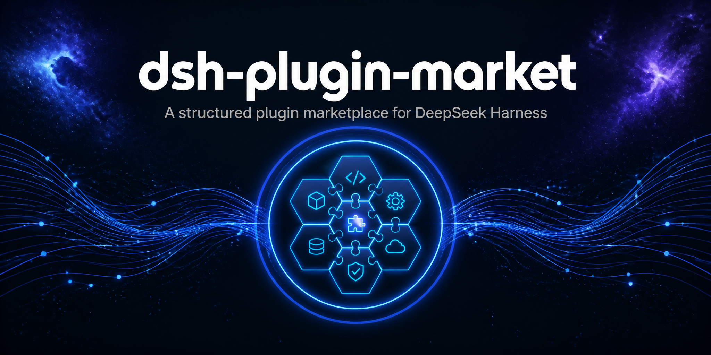

<div align="center">



# dsh-plugin-market

**A structured plugin marketplace for DeepSeek Harness — each plugin described as JSON, auto-aggregated into a single `plugins.json` for the dsh-plugins.github.io site.**

English | [简体中文](README.zh_CN.md)

</div>

## Directory Structure

```
plugins/                  # One JSON descriptor file per plugin
  dsh-plugins-<id>.json
scripts/
  aggregate.mjs           # Aggregation script: plugins/*.json → plugins.json
plugins.json              # Aggregated output (maintained by the workflow)
.github/workflows/
  aggregate.yml           # Aggregates on push to plugins/ + notifies the site repo
```

## Plugin Descriptor Format

```jsonc
{
  "id": "@dsh-plugin/dsh-auxiliary",        // Unique plugin id (npm package name or github:owner/repo)
  "name": "DSH Auxiliary",                  // Display name
  "description": [                          // Localized descriptions (optional; or a plain string)
    { "language": "en-US", "content": "..." },
    { "language": "zh-CN", "content": "..." }
  ],
  "support_versions": ">=0.1.0-rc.6",       // Supported dsh versions (semver range or array)
  "urls": {                                 // Project links (optional)
    "homepage": "https://github.com/dsh-plugins/dsh-auxiliary",
    "repository": "https://github.com/dsh-plugins/dsh-auxiliary",
    "issues": "https://github.com/dsh-plugins/dsh-auxiliary/issues"
  },
  "relationship": [                         // Dependency / conflict relations (optional)
    { "type": "dependency", "id": "@dsh-plugin/dsh-loader", "versions": ">=1.3.0" },
    { "type": "incompatibility", "id": "@dsh-plugin/dsh-auxiliary", "versions": "*" }
  ]
}
```

### Field Reference

- `id` — **Required.** Unique plugin identifier: an npm package name
  (`@scope/name`) or `github:owner/repo`.
- `name` — **Required.** Human-readable plugin name.
- `description` — Optional. A plain string or a localized array of
  `{language, content}` objects.
- `support_versions` — Optional. A semver range string (`>=0.1.0-rc.6`), an
  interval (`[0.1.0-rc.6, 0.1.1)`), or an array of versions
  (`["0.1.0-rc.6","0.1.0-rc.7"]`). Omitted means any version.
- `urls` — Optional. `{homepage, repository, issues}` links.
- `relationship` — Optional. `{type, id, versions}[]` where `type` ∈
  `dependency` | `incompatibility`, and `versions` is a semver range with
  `*` meaning any version.

### Version Number Rules

Version values in `support_versions` and `relationship[].versions` follow
the id kind:

- **npm package ids** (`@scope/name`) — use npm version numbers (e.g.
  `>=1.3.0`, `^0.14.0`).
- **GitHub ids** (`github:owner/repo`) — use a git tag (`v1.3.0`) or a
  commit hash (short or long, e.g. `dac813a`).

## Workflow

1. Add or update a plugin JSON under `plugins/` and push to `main`;
2. `aggregate.yml` auto-aggregates `plugins.json` and commits it back;
3. It notifies `dsh-plugins/dsh-plugins.github.io` via `repository_dispatch`
   (event type `plugins-updated`);
4. The site repo's `sync-plugins.yml` fetches `plugins.json`, writes it to
   `public/api/plugins.json`, and pushes, triggering its Pages deploy.

> Notifying the site repo requires `PLUGIN_MARKET_PAT` (a Personal Access
> Token with `contents: write` on `dsh-plugins.github.io`), configured under
> Settings → Secrets and variables → Actions in this repository.
>
> To create one: GitHub → Settings → Developer settings → Personal access
> tokens → Fine-grained tokens → Generate new token → select only the
> `dsh-plugins/dsh-plugins.github.io` repository, set Repository permissions
> → `Contents: Read and write` → generate and copy → in this repository
> Settings → Secrets and variables → Actions → New repository secret, name
> it `PLUGIN_MARKET_PAT` and save.
>
> With `PLUGIN_MARKET_PAT` configured, the site repo syncs and deploys
> automatically right after each push to `plugins/`.
